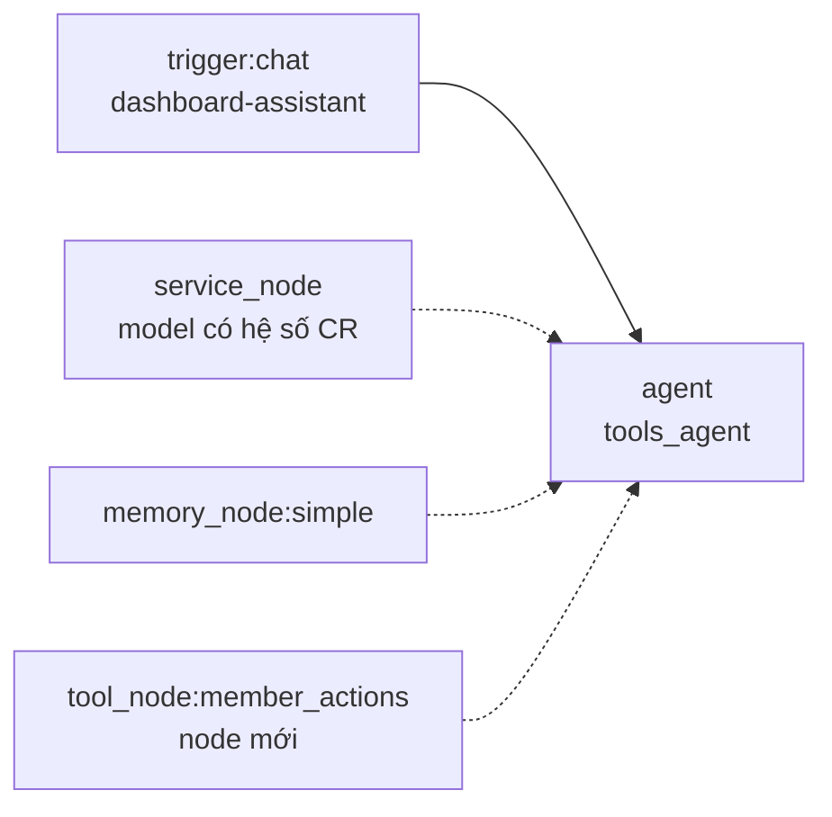

# Workflow: Dashboard Assistant

> **Trạng thái:** Node `member_actions` đã có trên canvas và runtime. Workflow vẫn phải publish + share rồi điền ba biến môi trường ở mục 4.  
> **Ngày:** 2026-10-13  
> **Màn hình:** `/dashboard/control/assistant`  
> **Thay cho:** `POST /dashboard/assistant/chat` (`ToolLoopAgent` trong `features/assistant/`)

Trợ lý trên dashboard phải là một workflow đã publish. Mỗi lượt chat đi qua chat trigger → Agent, và Agent trừ Credit của người đang đăng nhập. Không gọi model ở route assistant cũ.

---

## 1. Vì sao route cũ nguy hiểm

`POST /dashboard/assistant/chat` tạo `ToolLoopAgent` rồi gọi `billAgentUsage` trong `onFinish`. Lỗi tính phí bị nuốt (`console.error`). Nếu service `/dashboard/assistant/chat` không có hệ số Credit, `computeUsageCredits` trả 0. Vòng tool có thể gọi model nhiều bước nhưng không đi qua `billGenerateTextCalls`. Người dùng chat liên tục thì COGS tăng mà ví Credit không giảm.

Đường workflow thì khác. `POST /chat/:workflowId/:chatPath` chạy `runChatTrigger` → `executeAgent`. Mỗi bước model gọi `billAgentUsage` và ném lỗi khi ví không đủ. Execution `failed` thì HTTP trả lỗi, không có câu trả lời miễn phí.

Route builder `POST /dashboard/build/workflows/:id/chat` **không** dùng cho màn này. Nó stream rồi tính phí trong `onFinish` và cũng nuốt lỗi.

---

## 2. Ai bị trừ Credit

Chat production chỉ trừ ví người gọi khi workflow **vừa share vừa published**. `actorForPublicTrigger` khi đó lấy session hub và chạy với tư cách consumer. Workflow draft, hoặc published nhưng chưa share, chạy bằng ví **chủ workflow** — mọi user dashboard sẽ đốt Credit của một tài khoản.

Điều kiện bắt buộc:

| Việc | Giá trị |
|------|---------|
| Status | `published` |
| Share | bật, grant audience `all`, `triggerKinds` có `chat` |
| Chat public | `chatPublic: true` (production từ chối `false` trước cả bước đăng nhập) |
| Chat auth | `hub_users` |
| Chat path | `dashboard-assistant` |

`chatPublic: true` chỉ mở URL. `hub_users` vẫn chặn khách chưa đăng nhập.

Royalty: consumer trả Credit usage; chủ workflow nhận royalty theo cấu hình share. Đặt royalty 0 nếu nền tảng không muốn thu thêm trên trợ lý này.

---

## 3. Graph



Nét liền là data-flow (`out` → `in`). Nét đứt là resource.

Không dùng các node sau cho trợ lý này:

| Node | Lý do |
|------|--------|
| `http_request` gắn `asTool` | Gọi HTTP ra ngoài, không có xác nhận theo payload, không chạy service member trên UserDO của người gọi |
| `action_in_app` | Integration HTTP, không phải API key / đơn / ví |
| `human_review` | Dừng graph để duyệt email, không phải nút Đồng ý / Hủy trong chat |
| `reasoning_agent` | Vòng SQL/RAG, không phải thao tác dashboard |
| Tool RAG / SQL | Không đọc được overview, monitor, referral |

### 3.1 Node có sẵn

**Chat trigger**

```json
{
  "id": "trg_assistant",
  "type": "trigger",
  "data": {
    "label": "When chat message received",
    "triggerKind": "chat",
    "chatPath": "dashboard-assistant",
    "chatPublic": true,
    "chatMode": "hostedChat",
    "chatAuth": "hub_users",
    "initialMessages": "Xin chào. Mình hỗ trợ các việc trên dashboard của bạn."
  }
}
```

**Service** — resource, bắt buộc. Endpoint phải là service **approved** và đã có `creditCoeffInput` / `creditCoeffOutput`. Model có thể là `@cf/zai-org/glm-4.7-flash`, nhưng bản ghi service phải có hệ số Credit. Không trỏ vào endpoint chưa có pricing: charge sẽ là 0 dù Agent có chạy.

**Simple Memory** — `memoryKind: simple`, `sessionKey: "{{ $json.sessionId }}"`, `contextWindowLength: 10`. Chat trigger đã phát `sessionId`. Màn dashboard giữ một session trong `sessionStorage` và gửi lại mỗi lượt.

**Agent** — `agentKind: tools_agent`, `chatEntry: true`, `promptSource: from_input`, prompt `{{ $json.chatInput }}`. System prompt giữ các ràng buộc của trợ lý cũ: một ngôn ngữ theo tin đầu, không lộ tên tool, chỉ làm việc trong tool đang nối, URL thanh toán trả nguyên văn, không bịa kết quả. Thao tác ghi (tạo / hủy / thu hồi / hoàn tiền) phải hỏi xác nhận và kết thúc bằng dòng `__assistant_confirm_required__`. Không thực thi ghi nếu tin mới nhất của user không phải `__assistant_confirm_ok__` kèm đúng khóa xác nhận.

### 3.2 Node mới: `tool_node:member_actions`

Một node, không tách 19 node. Các việc dashboard là tool của cùng một UserDO, cùng một chính sách xác nhận. Tách từng việc ra canvas không thêm biên Credit và làm graph không dựng được.

| Thuộc tính | Giá trị |
|------------|---------|
| **ID** | `tool:member_actions` |
| **runtimeType** | `tool_node` |
| **toolKind** | `member_actions` |
| **Loại** | Resource (`skipExecution: true`) |
| **Nối** | `tools` → `agent.tools` |
| **LLM** | Không gọi. Credit chỉ phát sinh ở Agent |

Runtime đăng ký đúng các factory đang có trong `features/assistant/tools/`, scope theo user đang chạy workflow:

- Đọc, gọi ngay: `listApiKeys`, `getOrders`, `getOrderDetail`, `getServices`, `getAvailableVouchers`, `getPaymentMethods`, `queryPaymentTransaction`, `getOverview`, `getMonitorLogs`, `getMonitorAnalytics`, `getReferralLink`, `getReferralCommissionStats`, `getReferralCommissions`
- Ghi, bọc `withUserConfirmation`: `createApiKey`, `revokeApiKey`, `revokeAllApiKeys`, `createOrder`, `cancelOrder`, `createPaymentUrl`, `refundPayment`

Xác nhận giữ token hiện tại (`__assistant_confirm_ok__::<tool>:<payload>`). Màn dashboard đã có nút Đồng ý / Hủy và gửi token đó như `chatInput`.

Module dự kiến khi implement:

```
packages/workflow-nodes/src/nodes/tool/kinds.ts          thêm member_actions
workers/auth-worker/.../nodes/tool/member-actions/       đăng ký toolset vào agent runtime
```

Agent runtime chỉ được nhận tool này từ node nối vào Agent, cùng cách `buildRagToolset` nhận Get RAG. Không hard-code lại trong `features/assistant/agent.ts`.

Trước khi node này có trên canvas, workflow vẫn publish được với Chat + Service + Memory + Agent. Lượt chat đã trừ Credit, nhưng trợ lý chưa tạo key, đơn, hay link thanh toán. Không bật lại route cũ để “tạm” có các việc đó.

---

## 4. Màn `/dashboard/control/assistant`

Màn không gọi `POST /dashboard/assistant/chat`.

Mỗi lượt gửi:

```
POST {API}/chat/{workflowId}/dashboard-assistant?owner_id={ownerId}&format=json
Cookie: session hub
Accept: application/json

{ "action": "sendMessage", "sessionId": "<sessionStorage>", "chatInput": "<text>" }
```

| Biến | Ý nghĩa |
|------|---------|
| `NEXT_PUBLIC_DASHBOARD_ASSISTANT_WORKFLOW_ID` | id workflow đã publish |
| `NEXT_PUBLIC_DASHBOARD_ASSISTANT_OWNER_ID` | DO id chủ workflow, query `owner_id` |
| `NEXT_PUBLIC_DASHBOARD_ASSISTANT_CHAT_PATH` | mặc định `dashboard-assistant` |

Thiếu workflow id thì ô chat khóa, không fallback sang route cũ.

`output` trong JSON là câu trả lời. Nếu câu chứa `__assistant_confirm_required__`, hiện Đồng ý / Hủy. Đồng ý gửi `__assistant_confirm_ok__` (kèm confirmation key khi tool trả về). Hủy gửi `__assistant_confirm_cancel__`.

Route `POST /dashboard/assistant/chat` trả **410** và không gọi model.
